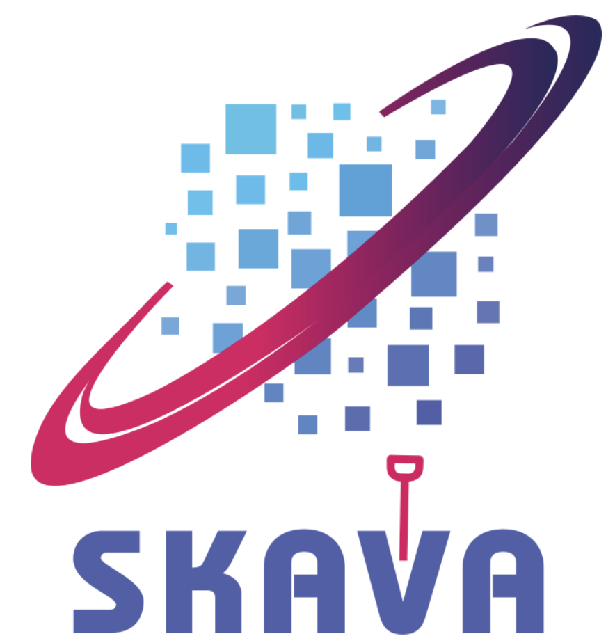

<p align="center">
  
</p>

<h3 align="center">Federated data discovery with compute-next-to-data routing<br>for the SKA Regional Centre network</h3>

<p align="center">
  <a href="https://github.com/VisIVOLab/SKAVA/actions/workflows/tests.yml"></a>
  <a href="https://skava.readthedocs.io"></a>
  <a href="https://doi.org/10.5281/zenodo.23765262"></a>
  <a href="LICENSE"></a>
  
</p>

<p align="center">
  <a href="https://skava.readthedocs.io">Documentation</a> ·
  <a href="https://skava.readthedocs.io/en/latest/getting-started/quickstart.html">Quick start</a> ·
  <a href="testbed/README.md">Testbed</a> ·
  <a href="docs/reference/changelog.md">Changelog</a>
</p>

---

**SKAVA** (SKA Visual Analytics) is a data discovery and access service for
federated astronomical archives, built for the SKA Regional Centre network
(SRCNet). It answers a scientific query not with a file to download but with
an *execution decision*: which copy of the dataset should serve the request,
which compute service sits next to that copy, and why.

A query resolves to a dataset, the dataset to its replicas across the
federation's nodes, and a ranking policy over the nodes' measured state
chooses among them. The answer is a standard IVOA DataLink document that
names the chosen node's services. The client then works on that node, and
the dataset itself is never transferred.

## Highlights

- **Discovery on ObsCore.** Cone, spectral, temporal, collection and type
  filters, and a bounded TAP/ADQL profile on `ivoa.obscore` with VOSI tables
  and capabilities, for pyvo and any VO client.
- **Explained routing.** Every DataLink response lists the replicas in rank
  order, each with a score and the reason for its place, and the replicas
  set aside with theirs. The default `resource_aware` policy ranks on
  what a background prober measures at each node: reachability, round-trip
  time, CPU pressure, queued work and free memory. A node the prober cannot
  reach reports the same state itself, with a token valid for that node
  only. A `static` policy ranks on scores the operator declares.
- **Compute next to the data.** The DataLink response advertises the
  services of the chosen node: its VisIVO backend, its SODA service, moment
  maps and position–velocity diagrams. `/soda/sync` redirects (303) to the
  node that holds the copy, so a standard SODA client receives the cutout
  from the node.
- **Federation.** `/federation/search` asks the catalogues of other sites
  with the caller's token and merges their answers on the dataset identity.
- **Identity.** OpenID Connect bearer tokens (the SRCNet IAM, or Keycloak),
  with the IVOA `ivoa_bearer` challenge.
- **Ingestion in place.** `skava-publisher` runs on each data node, reads
  file headers where they lie (FITS, HDF5, PSRFITS) and sends only metadata.
- **Operations.** A web admin for nodes, datasets, replicas, users and the
  audit log; Prometheus metrics, health and availability endpoints,
  structured JSON logs and Alembic migrations.

## How it works

```
 ADQL / ObsCore query
          │
          ▼
  logical dataset ──► replica set ──► policy engine ──► compute endpoint ──► execution
   (identity)          (copies on       (ranked, with      (services next       (on the node;
                        the nodes)       the reasons)       to the chosen copy)  the file stays)
```

SKAVA holds metadata only: datasets, their replicas, the nodes and what it
measures about them. It never reads or stores science files. Each Regional
Centre runs its own instance next to its nodes, and instances federate with
each other.

## Quick start

Requirements: Python 3.11 or later and PostgreSQL (SQLite works for
development).

```bash
git clone https://github.com/VisIVOLab/SKAVA.git
cd SKAVA
python3.11 -m venv .venv && source .venv/bin/activate
pip install -e ".[dev]"

alembic upgrade head          # the database named by SKAVA_DATABASE_URL
python -m app.seed            # a small demo catalogue
uvicorn app.main:app --reload
```

Or with Docker:

```bash
docker compose up --build     # http://localhost:8000
```

Then:

```bash
curl 'http://localhost:8000/discovery/search?POS=CIRCLE%20180%20-30%200.2'
curl 'http://localhost:8000/datalink/dataset-3'
curl 'http://localhost:8000/tap/sync?QUERY=SELECT%20TOP%205%20*%20FROM%20ivoa.obscore'
```

All settings are environment variables. `.env.example` lists the defaults,
and the [configuration reference](https://skava.readthedocs.io/en/latest/reference/env-vars.html)
explains each one. Production deployment, with TLS and a reverse proxy, is
described in the [deployment guide](https://skava.readthedocs.io/en/latest/deployment/production.html).

## A federation on one machine

[`testbed/`](testbed/README.md) brings up a reproducible federation with one
compose file. It has two catalogues, a Keycloak IAM, a Computing Broker
stand-in and four simulated SRC nodes. The nodes differ in memory, CPU, load
and network link, and each runs a VisIVO Visual Analytics backend next to
its own copies of the data.

```bash
cd testbed
make data up seed
```

The routing policy, the operations next to the data and the federation are
evaluated there; the experiment scripts are in
[`testbed/experiments/`](testbed/experiments/README.md) and their results in
`testbed/results/`.

## Clients

SKAVA is used from the SKAVA tab of
[VisIVO Visual Analytics](https://github.com/VisIVOLab/VisIVO-next). The
desktop searches the catalogue, shows the chosen node and the reason, opens
the dataset on that node, and runs cutouts, moment maps,
position–velocity diagrams and source finders there. Any client that speaks
TAP and DataLink can use the same service; the interfaces are described in
the [HTTP API reference](https://skava.readthedocs.io/en/latest/api/discovery.html).

## Development

```bash
pytest                                   # the service's test suite
cd tools/skava-publisher && pytest       # the publisher's own tests
```

See [Contributing](https://skava.readthedocs.io/en/latest/development/contributing.html)
and [Testing](https://skava.readthedocs.io/en/latest/development/testing.html).

## Citing SKAVA

If you use SKAVA in your work, please cite it using the metadata in
[`CITATION.cff`](CITATION.cff); GitHub's "Cite this repository" button gives
it in BibTeX and APA. The software is archived on Zenodo:
[10.5281/zenodo.23765262](https://doi.org/10.5281/zenodo.23765262) cites all
versions, [10.5281/zenodo.23766136](https://doi.org/10.5281/zenodo.23766136)
is 0.1.1 and [10.5281/zenodo.23765263](https://doi.org/10.5281/zenodo.23765263)
0.1.0.

## License

SKAVA is released under the [Apache License, Version 2.0](LICENSE). Redistributions and derivative works must keep the [NOTICE](NOTICE) file, which credits the authors and the project; the name and logo of SKAVA are not licensed for use by derivative works.

## Acknowledgements

This work was supported by the SKA Visual Analytics (SKAVA) project, funded
by the Italian National Institute for Astrophysics (INAF) under the
Astrophysics Fundamental Research Grant (Techno Grant).

SKAVA is developed by [VisIVOLab](https://github.com/VisIVOLab) at INAF –
Osservatorio Astrofisico di Catania, with INAF – Osservatorio Astronomico di
Trieste.
